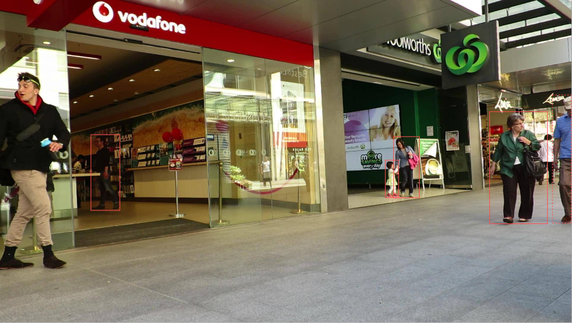
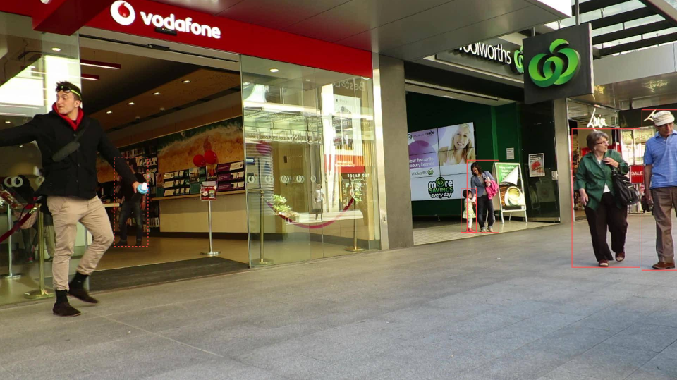
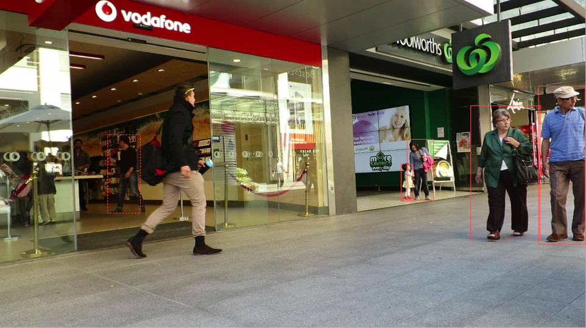

# Báo cáo cá nhân — Dang Trung Hieu — 2A202603248

Đoạn video: MOT17-09, 150 frame (frame 1–150), nguồn MOTChallenge, giấy phép CC BY-NC-SA 3.0.

Số frame trong báo cáo tính **theo CVAT** (bắt đầu từ 0). Trong `gt.txt`, `frame_id` = frame CVAT + 1. Video 30 fps, nên 30 frame = 1 giây.

## 0. Thông tin học viên

- Họ tên: Đặng Trung Hiếu
- MSSV: 2A202603248
- Mã đề (A/B/C): B
- Email: ladykiller12.2005@gmail.com
- Link repository: https://github.com/HieuGit05/K5-L2B-DAY05-DangTrungHieu-2A202603248-MOTTracking
- Giờ bắt đầu: 16h45 ngày 13/11/2026
- Giờ kết thúc: 12h ngày 14/11/2026

## 1. Xem trước đoạn video (CP0)

Năm người của đề B (theo `src/lab_variants.json`: ID gốc 1, 19, 20, 21, 22). Số frame lấy từ file xuất (`annotations.xml`, `gt.txt`) và đối chiếu với ảnh P1–P5.

| Mã | Frame xuất hiện | Frame cuối thấy được | Rẽ / dừng / đổi tốc độ ở frame | Bị che ở frame | Ghi chú |
|---|---|---|---|---|---|
| P1 | 0 | 149 | ~100: đổi từ đi sang phải sang quay lại phía trái và tiến gần camera (cao box 294 → 359 px) | 29–38 che một phần; 39–49 che hẳn; 50–58 che một phần | Người mặc đồ tối trong cửa hàng Vodafone, bị người áo đen đi ngang che (người này không thuộc 5 người, không gán). Bài test che khuất CP2 |
| P2 | 0 | 149 | Tăng tốc dần; nhanh hẳn từ ~90–110 (vx −3,9 → −7,2 px/frame) | Không bị che | Bà áo xanh lá, túi đen, đi từ mép phải về trái và lại gần camera (cao box 346 → 850 px) nên box đổi kích thước nhiều |
| P3 | 0 | 149 | 0–20: vào khung rất nhanh (cao box 168 → 429 px); ~90: tăng tốc (vx −1,3 → −5,9) | 0–29 che một phần (mới vào khung từ mép phải, chỉ thấy một phần) | Ông áo xanh dương, xuất hiện ở mép phải khung |
| P4 | 0 | 147 | Đi chậm sang phải đến ~40, rồi đứng yên (40–100) | 109 che một phần; 110–138 che hẳn; hiện lại ở 139; từ 148 bị chân người đi đường che hẳn | Bé gái nhỏ (cao box ~125 px), bị P2 đi ngang che |
| P5 | 0 | 108 | Đi sang phải đến ~20, gần như đứng yên từ ~40 | 100–108 che một phần; 109–149 che hẳn, không hiện lại | Phụ nữ túi hồng đứng cạnh bé gái, bị người đi đường che hẳn từ frame 109 |

## 2. Keyframe và thời gian (CP1, CP4)

Số keyframe lấy từ kết quả `src/check_submission.py` (không tính keyframe `outside`).

| Mã | Số keyframe | Keyframe ở frame | Số frame có mặt | Keyframe / 100 frame | Thời gian (phút) | Chỗ khó |
|---|---|---|---|---|---|---|
| P1 | 16 | 0, 10, 20, 29, 30, 50, 59, 60, 70, 80, 90, 100, 110, 129, 139, 149 | 139 | 11,5 | 30 phút | Đoạn che 29–58, phải giữ cùng ID khi hiện lại ở frame 50 |
| P2 | 16 | 0, 10, 20, 30, 40, 50, 60, 70, 80, 90, 100, 110, 119, 129, 139, 149 | 150 | 10,7 | 30 phút | Lại gần camera, box lớn nhanh và đi nhanh dần ở cuối đoạn |
| P3 | 16 | 0, 10, 20, 30, 40, 50, 60, 70, 80, 90, 100, 110, 119, 129, 139, 149 | 150 | 10,7 | 30 phút | Mới vào khung ở mép phải (frame 0–20), rồi tăng tốc sau frame 90 |
| P4 | 7 | 0, 10, 20, 30, 40, 109, 139 | 119 | 5,9 | 15 phút | Bị che hẳn 110–138 (29 frame) rồi hiện lại |
| P5 | 9 | 0, 10, 20, 30, 40, 50, 60, 70, 100 | 109 | 8,3 | 15 phút | Bị che dần từ 100 rồi mất hẳn từ 109 |
| **Tổng** | **64** | | **667** | **9,6** | 120 phút | |

Keyframe / 100 frame của cả bài = 64 ÷ 667 × 100 = **9,6**.

Bạn đặt keyframe nhiều nhất ở người nào? Vì sao (người đó rẽ, dừng, lại gần camera hay bị che)?

P1, P2 và P3 đều có 16 keyframe; P1 có mật độ cao nhất (11,5 keyframe / 100 frame). P1 cần keyframe dày quanh đoạn bị che (frame 29, 30, 50, 59, 60) để box giữ đúng vị trí ngay trước và sau khi che. P2 và P3 đi lại gần camera nên box to ra nhanh và nội suy tuyến tính dễ lệch, vì vậy mình đặt keyframe đều mỗi 10 frame. P4 và P5 đứng gần như yên nên chỉ cần 7–9 keyframe.

## 3. Đoạn bị che (CP2)

Người bị che: `P1`

| Mốc | Frame |
|---|---:|
| Bắt đầu bị che một phần (bật `occluded`) | 29 |
| Mất hẳn (bật `outside`) | 39 |
| Hiện lại (tắt `outside`) | 50 |
| Thấy rõ trở lại (tắt `occluded`) | 59 |

- Thời gian khuất hẳn: 11 frame (39–49) = 0,37 giây.
- Quyết định: **giữ cùng ID** (P1 là track số 5 trong file MOT; không tạo track mới).
- Lý do:
  1. **Khuất bao lâu so với 60 frame:** chỉ 11 frame (0,37 giây), nhỏ hơn nhiều so với ngưỡng 60 frame (2 giây).
  2. **Ngoại hình có khớp:** trước và sau khi che đều là người mặc đồ tối đứng trong cửa hàng Vodafone, cùng dáng và chiều cao box (~254 px ở frame 30 và ~254 px ở frame 51).
  3. **Chỗ hiện lại có đúng hướng và tốc độ không:** trước khi che tâm box ở x ≈ 374 (frame 30), sau khi hiện lại ở x ≈ 395 (frame 51), tức khoảng 1 px/frame, đúng với tốc độ chậm sang phải trước đó. Người đi ngang che là người áo đen không thuộc 5 người, nên không có khả năng nhầm với P1.

  Sau khi hiện lại ở frame 50, P1 vẫn còn bị che một phần (thấy đầu và chân), nên mình bật `occluded` cho tới frame 58 và giữ box bao toàn thân ước lượng, không co box theo phần nhìn thấy.

Ảnh chụp màn hình:







## 4. Tự review ID (CP3)

Lượt 1 theo người (đi ngược từ frame 149 về 0 trên CVAT), lượt 2 theo cảnh (nhảy 10 frame).

| Frame | Mã người | Loại lỗi | Mô tả một câu | Phát hiện ở lượt | Đã sửa? |
|---:|---|---|---|---|---|
| 30–50 | (không thuộc 5 người) | `false_track` | Đã vẽ một track thừa cho người áo đen đi ngang che P1 (track số 6), không thuộc 5 người được giao | 1 | Có, file xuất chỉ còn đúng 5 track |
| 50 | P1 | `flag` | Khi P1 hiện lại, phải tắt `outside` và bật `occluded` trên cùng track thay vì vẽ track mới; ban đầu `outside` còn bật ở frame 50 | 1 | Có, file xuất cho thấy `outside` 39–49 và `occluded` 50–58 |
| 148 | P4 | `flag` | Bé gái P4 ở frame 148 bị chân người đi đường che hẳn nhưng box vẫn còn hiện, thiếu cờ `outside` | 1 | Có, đã bật `outside` từ frame 148 và xuất lại file (P4 hết ở frame 147) |

Tổng hợp số lỗi theo loại:

| `id_switch` | `fragmentation` | `lost` | `merge` | `false_track` | `drift` | `flag` |
|---:|---:|---:|---:|---:|---:|---:|
| 0 | 0 | 0 | 0 | 1 | 0 | 2 |

Lỗi nào chỉ lượt 2 (theo cảnh) mới thấy, lượt 1 (theo người) không thấy? Vì sao?

Trong job của mình không có lỗi nào chỉ lượt 2 mới thấy: cả ba lỗi ở bảng trên đều được phát hiện ở lượt 1. Về nguyên tắc, những lỗi như `false_track` (box trên người không được giao) hoặc `merge` (một box bao hai người) dễ lộ ra ở lượt 2 hơn, vì khi nhìn cả cảnh thấy ngay box thừa hoặc box bao hai người, còn ở lượt 1 mình chỉ nhìn từng người đang theo dõi. Ngược lại `drift` và `flag` của từng người dễ thấy hơn ở lượt 1 vì đi từng frame theo một người.

## 5. File xuất và kết quả tự kiểm (CP4)

| Kiểm tra | Kết quả |
|---|---|
| Tên file MOT 1.1 | `src/exports/DangTrungHieu_mot.zip` |
| Tên file CVAT for video 1.1 | `src/exports/DangTrungHieu_cvat_video.zip` |
| Số track ID khác nhau trong `gt/gt.txt` (phải là 5) | 5 (ID 1–5) |
| Frame `outside` không có dòng trong `gt.txt` (đúng / sai) | Đúng: P1 (ID 5) vắng ở frame CVAT 39–49, có 139 dòng thay vì 150 |
| Job đã completed trên CVAT máy cá nhân | đã completed |

Tóm tắt in ra từ `src/check_submission.py`:

```text
=== File MOT 1.1: DangTrungHieu_mot.zip ===
  Số track ID: 5   |   Tổng số box: 667
  [OK]        Đúng 5 track ID.

  Track | Frame có mặt | Số frame | Đoạn vắng (outside)
      1 |   0–149      |      150 | -
      2 |   0–149      |      150 | -
      3 |   0–147      |      119 | 110–138
      4 |   0–108      |      109 | -
      5 |   0–149      |      139 | 39–49

=== File CVAT for video 1.1: DangTrungHieu_cvat_video.zip ===

  Track | Nhãn   | Frame thấy | Keyframe | KF/100 frame | Frame occluded | Lần bật outside
      0 | person |        150 |       16 |         10.7 |              0 |               0
      1 | person |        150 |       16 |         10.7 |             30 |               0
      2 | person |        119 |        7 |          5.9 |              1 |               2
      3 | person |        109 |        9 |          8.3 |              9 |               1
      4 | person |        139 |       16 |         11.5 |             19 |               1

  Tổng: 64 keyframe / 667 frame có mặt = 9.6 keyframe / 100 frame
  [OK]        Đọc được 5 track từ annotations.xml.

=== Tóm tắt ===
  Lỗi: 0   |   Cảnh báo: 0
  Đạt.
```

Ghi chú: trong bảng của script, track 0–4 (CVAT) tương ứng ID 1–5 trong `gt.txt` và tương ứng P2, P3, P4, P5, P1.

## 6. Ba câu kết

1. Nếu được gán lại, bạn sẽ đặt keyframe khác ở đâu? Vì sao?

   Mình sẽ đặt keyframe dày hơn (mỗi 5 frame) cho P2 và P3 sau frame 90. Ở đoạn này hai người đi nhanh hơn nhiều (P3: vx từ −1,3 lên −5,9 px/frame; P2: từ −3,9 lên −7,2) và lại gần camera nên box to ra nhanh, trong khi mình chỉ đặt keyframe mỗi 10 frame, nội suy tuyến tính dễ lệch. Ngược lại P4 và P5 đứng gần yên nên có thể giảm keyframe.

2. Có chỗ nào bạn không chắc "cùng ID hay ID mới"? Bạn đã quyết định và ghi chú thế nào?

   Chỗ không chắc nhất là P5: từ frame 109 chị bị người đi đường che hẳn và đến frame 149 vẫn chưa thấy lại rõ. Mình giữ `outside` đến hết video và không tạo track mới, vì khuất chưa quá 60 frame và không có ứng viên nào đúng ngoại hình. Với P1 (frame 39–49) mình chắc chắn cùng ID vì chỉ khuất 11 frame, cùng ngoại hình và đúng hướng đi (mục 3).

3. Một lỗi ID trong job của bạn (nếu không còn sót, chọn lỗi đã sửa) có thể làm xe tự lái dự đoán sai chuyển động của người đó như thế nào? Lỗi đó ảnh hưởng MOTA hay IDF1 nhiều hơn?

   Lỗi ID điển hình trong job này là `fragmentation` ở P1: nếu khi P1 hiện lại ở frame 50 mình vẽ một track mới thay vì tắt `outside` trên track cũ, hệ thống sẽ thấy một người biến mất đột ngột và một người lạ xuất hiện. Quỹ đạo và vận tốc đã học của P1 bị bỏ đi (khoảng 1 px/frame trước khi che), nên xe không dự đoán được người này sẽ tiếp tục đi theo hướng cũ. Lỗi này ảnh hưởng **IDF1** nhiều hơn MOTA: IDF1 phạt cả phần track phía sau chỗ ID bị đổi (người đó bị gán sai ID trong toàn bộ các frame còn lại), còn MOTA chỉ phạt một lần cho mỗi lần đổi ID.

## Bonus (nếu làm)

Chưa làm bonus (file xuất chỉ có 5 track, không có track phụ).

## 7. Tài liệu tham khảo và công cụ AI đã dùng

- Tài liệu của lớp: `README.md`, `CHECKPOINTS.md`, `docs/GUIDELINE.md`, `docs/CVAT_CHEATSHEET.md`, `docs/MOT_FORMAT.md`, `lab_day05_walkthrough.md`.
- Công cụ: CVAT local, `src/setup_local_lab.py`, `src/check_submission.py`.
- Dữ liệu: MOT17-09 từ MOTChallenge (CC BY-NC-SA 3.0).
- Công cụ AI: Claude Code (Anthropic). Dùng để sửa lỗi tải dữ liệu trong `src/setup_local_lab.py` (chứng chỉ SSL của motchallenge.net hết hạn), giải thích khi nào dùng `occluded` / `outside`.
